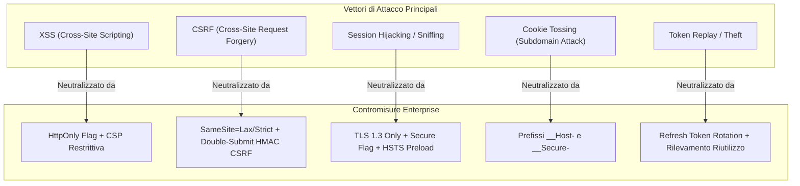
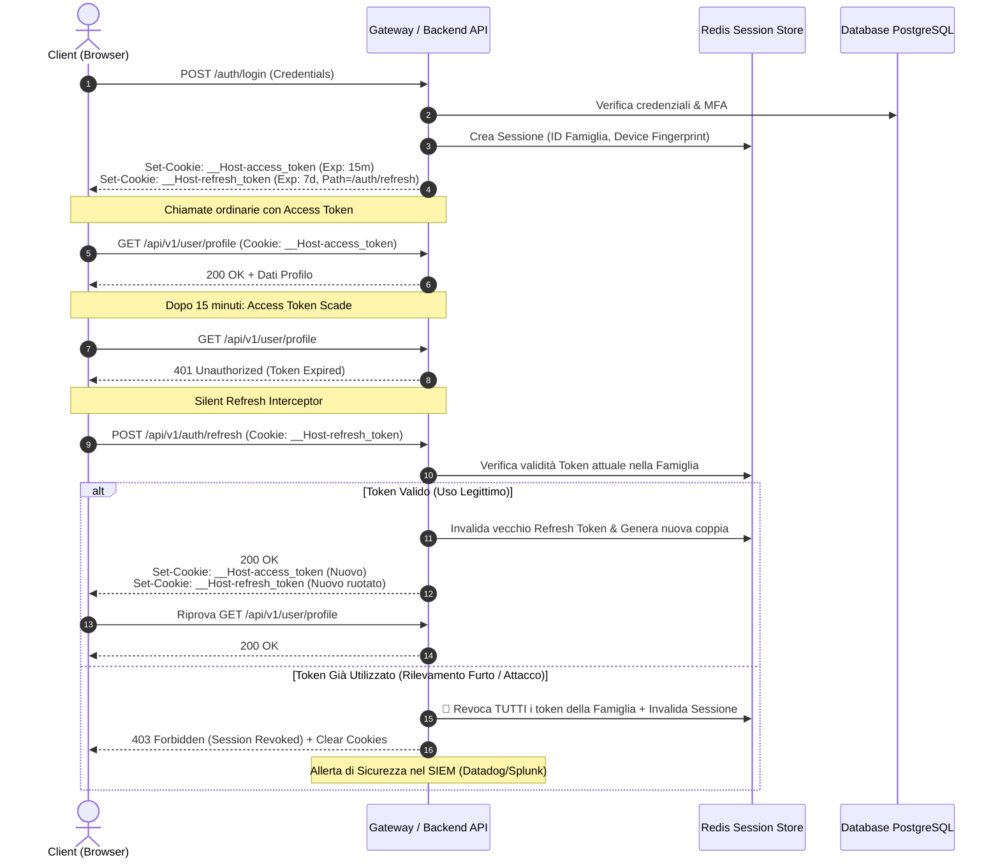
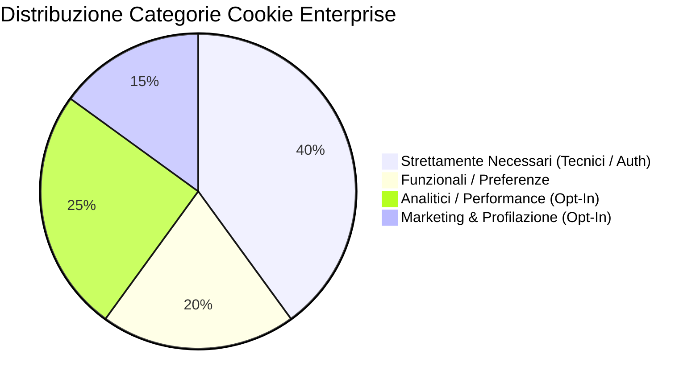
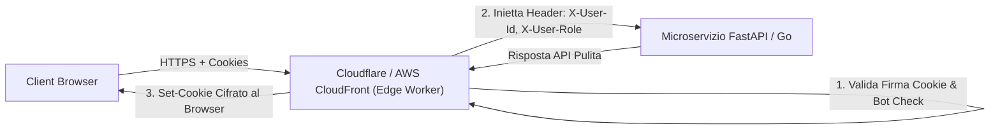

# 🛡️ Enterprise Cookie & Session Security Architecture
> **Guida Architetturale Definitiva**: Come le grandi aziende tecnologiche (FAANG, Fortune 500, Fintech) progettano, implementano e scalano il layer applicativo di Cookie, Autenticazione e Privacy.

---

## 📑 Indice dei Contenuti

1. [Executive Summary & Il Cambio di Paradigma](#1-executive-summary--il-cambio-di-paradigma)
2. [Modello di Minaccia (Threat Model) & Vettori di Attacco](#2-modello-di-minaccia-threat-model--vettori-di-attacco)
3. [Architettura di Autenticazione Ibrida (Access Token + Refresh Token Rotation)](#3-architettura-di-autenticazione-ibrida-access-token--refresh-token-rotation)
4. [Specifiche Tecniche dei Cookie Enterprise](#4-specifiche-tecniche-dei-cookie-enterprise)
5. [Pattern Multi-Dominio e Single Sign-On (SSO)](#5-pattern-multi-dominio-e-single-sign-on-sso)
6. [GDPR, ePrivacy & Consent Management Platform (CMP)](#6-gdpr-eprivacy--consent-management-platform-cmp)
7. [Implementazione Pratica Production-Ready](#7-implementazione-pratica-production-ready)
   - [Backend: FastAPI, Redis Cluster & CSRF Protection](#backend-fastapi-python)
   - [Frontend: React, TypeScript & Axios Silent Refresh Interceptor](#frontend-react-typescript)
8. [Edge Computing & Reverse Proxy (Cloudflare / Envoy)](#8-edge-computing--reverse-proxy-cloudflare--envoy)
9. [Observability, Auditing & Revoca Immediata delle Sessioni](#9-observability-auditing--revoca-immediata-delle-sessioni)
10. [Checklist di Conformità e Sicurezza per il Rilascio in Produzione](#10-checklist-di-conformit%C3%A0-e-sicurezza-per-il-rilascio-in-produzione)

---

## 1. Executive Summary & Il Cambio di Paradigma

Nello sviluppo web amatoriale o di prototipi, è pratica comune salvare i token JWT in `localStorage` o `sessionStorage`. Nelle **grandi aziende tecnologiche e negli ambienti enterprise/fintech**, questa pratica è **categoricamente vietata** e considerata una vulnerabilità critica di sicurezza (CWE-312 / CWE-922).

### Il Principio Zero-Trust sul Client
Il browser è considerato un ambiente non attendibile ed ostile:
- Qualsiasi script JavaScript in esecuzione sulla pagina (inclusi pacchetti npm di terze parti, tag di analytics, script CDN) ha pieno accesso a `localStorage`.
- I cookie configurati correttamente con il flag `HttpOnly` sono **invisibili al motore JavaScript**: il browser li gestisce a livello di stack di rete nativo C++, impedendo l'esfiltrazione in caso di vulnerabilità XSS.

```
┌────────────────────────────────────────────────────────────────────────┐
│                        ARCHITETTURA COMPARATIVA                        │
├────────────────────────────────────────┬───────────────────────────────┤
│ ❌ Approccio "Naive" (Non Enterprise)   │ ✅ Approccio Enterprise Big-Tech │
├────────────────────────────────────────┼───────────────────────────────┤
│ • JWT in localStorage                  │ • Cookie HttpOnly + Secure    │
│ • Esposto al 100% ad attacchi XSS      │ • Immune a esfiltrazione XSS  │
│ • Nessuna rotazione dei token          │ • Refresh Token Rotation (RTR)│
│ • Banner cookie fittizio (non blocca)  │ • Zero-Cookie Default & CMP   │
│ • Sessioni non revocabili prima della  │ • Revoca istantanea via Redis │
│   scadenza naturale del JWT            │   Cluster & Device Tracking   │
└────────────────────────────────────────┴───────────────────────────────┘
```

---

## 2. Modello di Minaccia (Threat Model) & Vettori di Attacco

Le grandi aziende progettano la gestione delle sessioni difendendosi sistematicamente da 5 vettori di attacco primari:



### 1. Cross-Site Scripting (XSS)
- **Rischio**: Iniezione di script malevolo via vulnerabilità nel DOM, supply-chain (npm) o input non sanificato.
- **Difesa Enterprise**: `HttpOnly=True`. Nessuna API JS (`document.cookie`) può leggere il cookie. Anche in presenza di XSS, l'attaccante non può rubare la chiave di sessione a lungo termine.

### 2. Cross-Site Request Forgery (CSRF)
- **Rischio**: Poiché il browser include automaticamente i cookie nelle richieste verso il dominio emittente, una pagina malevola potrebbe forzare richieste non autorizzate (es. POST verso `/api/v1/payments/transfer`).
- **Difesa Enterprise**: 
  - Attributo `SameSite=Lax` o `SameSite=Strict`.
  - Pattern **Double Submit Cookie** con HMAC crittografico o intestazione custom obbligatoria (`X-Requested-With`, `X-CSRF-Token`). Poiché il browser vieta alle richieste cross-origin di impostare header arbitrari senza preflight CORS (`OPTIONS`) con consenso esplicito, l'attacco fallisce.

### 3. Cookie Tossing & Subdomain Hijacking
- **Rischio**: In architetture con molti sottodomini (es. `marketing.azienda.com`, `user-content.azienda.com`), un sottodominio vulnerabile o compromesso può iniettare un cookie falso sovrascrivendo quello del dominio principale.
- **Difesa Enterprise**: Prefisso standard RFC 6265bis `__Host-` (es. `__Host-auth-token`). Obbliga il cookie ad essere inviato solo su HTTPS, confinato al dominio esatto (senza wildcard sui sottodomini) e con `path=/`.

---

## 3. Architettura di Autenticazione Ibrida (Access Token + Refresh Token Rotation)

Le aziende leader adottano un modello a doppio token asincrono gestito via cookie:

1. **Access Token (Breve durata, 5-15 minuti)**:
   - Utilizzato per autorizzare le chiamate API quotidiane.
   - Può essere tenuto in memoria (variabile JavaScript non persistita) oppure in un cookie `__Host-access-token` con durata ultra-corta.
2. **Refresh Token (Lunga durata, 7-30 giorni)**:
   - Emesso **esclusivamente** come cookie `HttpOnly; Secure; SameSite=Strict; Path=/api/v1/auth/refresh`.
   - Limitando il `Path` al solo endpoint di refresh, il browser **non trasmetterà** questo cookie in tutte le altre chiamate API ordinarie, riducendo l'overhead di rete e l'esposizione.
3. **Automatic Reuse Detection (Rilevamento del Furto)**:
   - Se un token di refresh revocato o già consumato viene ripresentato al server, il sistema identifica un tentativo di compromissione: **l'intera famiglia di token e tutte le sessioni attive dell'utente su quel dispositivo vengono revocate istantaneamente**.

### Flusso Sequenziale di Autenticazione & Rotazione



---

## 4. Specifiche Tecniche dei Cookie Enterprise

Ogni cookie generato in un'infrastruttura enterprise rispetta rigorosamente i flag RFC 6265bis e i vincoli di sicurezza minimi:

| Flag / Attributo | Valore Enterprise | Giustificazione Tecnica |
| :--- | :--- | :--- |
| **`HttpOnly`** | `true` | Impedisce l'accesso da codice JavaScript (`document.cookie`), neutralizzando l'esfiltrazione XSS. |
| **`Secure`** | `true` | Il cookie viene inviato **esclusivamente** su connessioni TLS/HTTPS cifrate. In ambienti locali di test è disattivato solo tramite variabili d'ambiente. |
| **`SameSite`** | `Lax` o `Strict` | Protezione CSRF integrata nel browser. `Strict` per endpoint critici; `Lax` per consentire navigazione iniziale da link esterni (es. email di reset password). |
| **`Path`** | `/` oppure `/api/v1/auth/refresh` | Minimizza l'invio non necessario di cookie pesanti o sensibili alle sole rotte che ne richiedono la presenza. |
| **`Domain`** | *Non impostato* (Host-Only) | Omettendo l'attributo `Domain`, il cookie non viene trasmesso ai sottodomini, prevenendo attacchi di cookie injection. |
| **Prefisso `__Host-`** | Obbligatorio su token primari | Il browser accetta il cookie solo se rispetta contemporaneamente: `Secure`, nessun `Domain` (host-only) e `Path=/`. |
| **`Max-Age` / `Expires`**| Esplicito e controllato | Sessioni volatili per dati transitori; TTL deterministico basato su policy aziendale per sessioni persistenti. |

### Esempio di Intestazione HTTP `Set-Cookie` Generata
```http
Set-Cookie: __Host-access_token=eyJhbGciOi...; Path=/; Secure; HttpOnly; SameSite=Lax; Max-Age=900
Set-Cookie: __Host-refresh_token=d9c7e0f2...; Path=/api/v1/auth/refresh; Secure; HttpOnly; SameSite=Strict; Max-Age=604800
Set-Cookie: XSRF-TOKEN=c9a14e6f...; Path=/; Secure; SameSite=Lax; Max-Age=900
```
*(Nota: `XSRF-TOKEN` è leggibile da JS per consentire al client di inviarlo nell'header `X-CSRF-Token`, implementando il Double Submit Cookie).*

---

## 5. Pattern Multi-Dominio e Single Sign-On (SSO)

Quando un'azienda gestisce ecosistemi complessi (es. `accounts.azienda.com`, `app.azienda.com`, `billing.azienda.com`), i cookie `Host-Only` non possono viaggiare tra domini di secondo livello differenti. Le grandi aziende risolvono questo problema con due pattern industriali:

### Pattern A: Identity Provider Gateway (OIDC / OAuth 2.0 PKCE)
Utilizzato da Google, Microsoft e Okta:
1. L'utente effettua il login su `accounts.azienda.com`. Viene generato un cookie di sessione primario valido solo per l'IdP.
2. Quando l'utente naviga su `app.azienda.com`, viene reindirizzato con un flusso OAuth2 Authorization Code + PKCE (`code_verifier`).
3. L'app client riceve un codice di autorizzazione temporaneo one-time e lo scambia back-channel con i propri cookie dedicati specifici per `app.azienda.com`.
4. **Vantaggio**: Nessuna condivisione pericolosa di cookie cross-origin; ogni micro-applicazione possiede una sessione isolata.

### Pattern B: Parent Domain Cookie Scoping
Utilizzato per sottodomini strettamente correlati:
- Cookie emesso con `Domain=.azienda.com`.
- `SameSite=Lax`.
- **Attenzione**: Questo pattern richiede un'accurata segregazione dei sottodomini per impedire che un'applicazione vulnerabile su `demo.azienda.com` comprometta `core.azienda.com`.

---

## 6. GDPR, ePrivacy & Consent Management Platform (CMP)

In Europa (GDPR & Direttiva ePrivacy 2002/58/CE) e negli USA (CCPA/CPRA), i cookie sono considerati identificatori personali online (Art. 4(1) GDPR).

### La Classificazione Rigorosa a 4 Livelli



1. **Strettamente Necessari (Technical / Essential)**:
   - **Esempi**: Token di sessione (`__Host-auth`), token anti-CSRF, bilanciamento di carico, flag di consenso GDPR salvato.
   - **Base Giuridica**: Art. 6(1)(f) GDPR (Legittimo Interesse) / Deroga ePrivacy Art. 5(3).
   - **Regola**: **NON richiedono consenso preventivo**. Possono essere installati immediatamente.
2. **Funzionali (Preferences)**:
   - **Esempi**: Lingua selezionata, tema scuro/chiaro, valuta preferita.
   - **Regola**: Possono richiedere notifica o consenso leggero.
3. **Analitici (Performance & Telemetria)**:
   - **Esempi**: PostHog self-hosted, Google Analytics 4, Datadog RUM.
   - **Regola**: Richiedono **consenso esplicito e preventivo (Opt-In)** a meno che non siano anonimizzati lato server con mascheramento IP completo e senza condivisione con terze parti (Linee Guida Garante Privacy).
4. **Marketing & Tracciamento Terze Parti**:
   - **Esempi**: Meta Pixel, TikTok Pixel, Google Ads, LinkedIn Insight Tag.
   - **Regola**: **Zero-Cookie Default**. È tassativamente vietato scaricare o eseguire gli script relativi prima del click su *"Accetta Tutti"* o *"Accetta Selezionati"*.

### Google Consent Mode v2
Nelle enterprise, il consenso viene sincronizzato con le API native dei vendor:
```javascript
// Stato di Default Prima dell'interazione dell'utente: BLOCCO TOTALE
gtag('consent', 'default', {
  'ad_storage': 'denied',
  'ad_user_data': 'denied',
  'ad_personalization': 'denied',
  'analytics_storage': 'denied'
});
```

---

## 7. Implementazione Pratica Production-Ready

Di seguito l'implementazione architetturale reale adottata nei moderni stack asincroni (FastAPI + Redis + React/TypeScript).

### Backend: FastAPI (Python)

#### 1. Configurazione e Helper dei Cookie Sicuri
```python
# app/core/security_cookies.py
import os
import secrets
import hmac
import hashlib
from fastapi import Response, HTTPException, status
from pydantic import BaseModel

IS_PRODUCTION = os.getenv("ENVIRONMENT", "development") == "production"
CSRF_SECRET_KEY = os.getenv("CSRF_SECRET_KEY", "super-secret-system-key-change-in-prod")

class CookiePolicy:
    ACCESS_TOKEN_NAME = "__Host-access_token" if IS_PRODUCTION else "access_token"
    REFRESH_TOKEN_NAME = "__Host-refresh_token" if IS_PRODUCTION else "refresh_token"
    CSRF_COOKIE_NAME = "XSRF-TOKEN"
    
    # TTL in secondi
    ACCESS_TOKEN_TTL = 15 * 60       # 15 minuti
    REFRESH_TOKEN_TTL = 7 * 86400    # 7 giorni

def generate_csrf_token(session_id: str) -> str:
    """Genera un token CSRF crittograficamente firmato legato alla sessione."""
    signature = hmac.new(
        CSRF_SECRET_KEY.encode(),
        session_id.encode(),
        hashlib.sha256
    ).hexdigest()
    return f"{session_id}.{signature}"

def verify_csrf_token(token: str) -> bool:
    """Verifica l'integrità e la firma crittografica del token Double Submit CSRF."""
    try:
        session_id, signature = token.split(".", 1)
        expected = hmac.new(
            CSRF_SECRET_KEY.encode(),
            session_id.encode(),
            hashlib.sha256
        ).hexdigest()
        return hmac.compare_digest(signature, expected)
    except Exception:
        return False

def set_auth_cookies(response: Response, access_token: str, refresh_token: str, session_id: str):
    """
    Imposta l'intero set di cookie crittografici con conformità RFC 6265bis.
    """
    # 1. Access Token (Utilizzato per tutte le chiamate API)
    response.set_cookie(
        key=CookiePolicy.ACCESS_TOKEN_NAME,
        value=access_token,
        max_age=CookiePolicy.ACCESS_TOKEN_TTL,
        expires=CookiePolicy.ACCESS_TOKEN_TTL,
        httponly=True,
        secure=IS_PRODUCTION,
        samesite="lax",
        path="/"
    )
    
    # 2. Refresh Token (Isolato esclusivamente alla rotta di refresh per minimizzare l'esposizione)
    response.set_cookie(
        key=CookiePolicy.REFRESH_TOKEN_NAME,
        value=refresh_token,
        max_age=CookiePolicy.REFRESH_TOKEN_TTL,
        expires=CookiePolicy.REFRESH_TOKEN_TTL,
        httponly=True,
        secure=IS_PRODUCTION,
        samesite="strict",
        path="/api/v1/auth/refresh"
    )
    
    # 3. Token CSRF (Leggibile dal client per Double-Submit Pattern)
    csrf_token = generate_csrf_token(session_id)
    response.set_cookie(
        key=CookiePolicy.CSRF_COOKIE_NAME,
        value=csrf_token,
        max_age=CookiePolicy.REFRESH_TOKEN_TTL,
        httponly=False,  # Intenzionale: JS deve poterlo leggere e includere nell'header X-CSRF-Token
        secure=IS_PRODUCTION,
        samesite="lax",
        path="/"
    )

def clear_auth_cookies(response: Response):
    """Invalida immediatamente tutti i cookie di sessione."""
    for cookie_name in [CookiePolicy.ACCESS_TOKEN_NAME, CookiePolicy.CSRF_COOKIE_NAME]:
        response.delete_cookie(key=cookie_name, path="/")
    response.delete_cookie(key=CookiePolicy.REFRESH_TOKEN_NAME, path="/api/v1/auth/refresh")
```

#### 2. Middleware Anti-CSRF Globale
```python
# app/core/csrf_middleware.py
from starlette.middleware.base import BaseHTTPMiddleware
from starlette.requests import Request
from starlette.responses import JSONResponse
from app.core.security_cookies import verify_csrf_token, CookiePolicy

SAFE_METHODS = {"GET", "HEAD", "OPTIONS", "TRACE"}

class CSRFProtectMiddleware(BaseHTTPMiddleware):
    async def dispatch(self, request: Request, call_next):
        # 1. I metodi idempotenti di lettura non necessitano di verifica CSRF
        if request.method in SAFE_METHODS:
            return await call_next(request)
        
        # 2. Escludi endpoint pubblici di autenticazione iniziale se necessario
        if request.url.path in ["/api/v1/auth/login", "/api/v1/auth/register"]:
            return await call_next(request)
        
        # 3. Verifica Double Submit Cookie:
        cookie_csrf = request.cookies.get(CookiePolicy.CSRF_COOKIE_NAME)
        header_csrf = request.headers.get("X-CSRF-Token")
        
        if not cookie_csrf or not header_csrf:
            return JSONResponse(
                status_code=403,
                content={"detail": "CSRF verification failed: Missing CSRF token or header."}
            )
            
        if cookie_csrf != header_csrf or not verify_csrf_token(header_csrf):
            return JSONResponse(
                status_code=403,
                content={"detail": "CSRF verification failed: Invalid cryptographic token."}
            )
            
        return await call_next(request)
```

---

### Frontend: React / TypeScript

Nel frontend, non manipoliamo mai manualmente i cookie di autenticazione. Configureremo un'istanza centralizzata di `Axios` con **interceptor automatico per il Silent Refresh**.

#### 1. Client HTTP Centralizzato con Interceptor di Concorrenza
```typescript
// frontend/src/api/client.ts
import axios, { AxiosError, InternalAxiosRequestConfig } from 'axios';

export const apiClient = axios.create({
  baseURL: import.meta.env.VITE_API_BASE_URL || '/api/v1',
  withCredentials: true, // FONDAMENTALE: permette al browser di inviare e ricevere cookie HttpOnly
  headers: {
    'Content-Type': 'application/json',
  },
});

// Helper per estrarre il token CSRF dal cookie XSRF-TOKEN
function getCsrfTokenFromCookie(): string | null {
  const match = document.cookie.match(new RegExp('(^| )XSRF-TOKEN=([^;]+)'));
  return match ? decodeURIComponent(match[2]) : null;
}

// 1. Request Interceptor: Inietta l'header CSRF su tutte le chiamate mutazionali
apiClient.interceptors.request.use((config: InternalAxiosRequestConfig) => {
  if (config.method && !['get', 'head', 'options'].includes(config.method.toLowerCase())) {
    const csrfToken = getCsrfTokenFromCookie();
    if (csrfToken) {
      config.headers.set('X-CSRF-Token', csrfToken);
    }
  }
  return config;
});

// 2. Response Interceptor: Gestione della scadenza e coda delle chiamate concorrenti
let isRefreshing = false;
let failedQueue: Array<{
  resolve: (value?: unknown) => void;
  reject: (reason?: unknown) => void;
}> = [];

const processQueue = (error: Error | null = null) => {
  failedQueue.forEach((promise) => {
    if (error) {
      promise.reject(error);
    } else {
      promise.resolve();
    }
  });
  failedQueue = [];
};

apiClient.interceptors.response.use(
  (response) => response,
  async (error: AxiosError) => {
    const originalRequest = error.config as InternalAxiosRequestConfig & { _retry?: boolean };

    // Se l'errore è 401 e la richiesta non è già un tentativo di retry o la rotta di login/refresh
    if (
      error.response?.status === 401 &&
      !originalRequest._retry &&
      !originalRequest.url?.includes('/auth/login') &&
      !originalRequest.url?.includes('/auth/refresh')
    ) {
      if (isRefreshing) {
        // Se c'è già un refresh in corso, accoda le altre chiamate concorrenti
        return new Promise((resolve, reject) => {
          failedQueue.push({ resolve, reject });
        })
          .then(() => apiClient(originalRequest))
          .catch((err) => Promise.reject(err));
      }

      originalRequest._retry = true;
      isRefreshing = true;

      try {
        // Chiama l'endpoint di refresh: il browser invierà automaticamente il cookie __Host-refresh_token
        await apiClient.post('/auth/refresh');
        
        processQueue(null);
        return apiClient(originalRequest);
      } catch (refreshError) {
        processQueue(refreshError as Error);
        // Se il refresh token è scaduto o compromesso, reindirizza alla schermata di login
        window.location.href = '/login?session_expired=true';
        return Promise.reject(refreshError);
      } finally {
        isRefreshing = false;
      }
    }

    return Promise.reject(error);
  }
);
```

---

## 8. Edge Computing & Reverse Proxy (Cloudflare / Envoy)

Nelle architetture ad alto traffico, la validazione e la manipolazione dei cookie non raggiungono nemmeno i server applicativi backend:



### Ruoli del Layer Edge:
1. **Edge Auth Validation**: I worker Cloudflare / Lambda@Edge verificano la firma crittografica del cookie di sessione direttamente nel PoP (Point of Presence) più vicino all'utente. Le richieste contraffatte o prive di cookie vengono respinte con latenza < 10ms.
2. **Cookie Stripping**: Il gateway rimuove i cookie dalle richieste verso asset statici (immagini, file JS/CSS compressi, video) riducendo drasticamente il consumo di banda e migliorando il caching su CDN.

---

## 9. Observability, Auditing & Revoca Immediata delle Sessioni

Una lacuna comune dell'autenticazione JWT pura è l'impossibilità di invalidare un token prima della sua naturale scadenza temporale. Le grandi aziende risolvono questo problema unendo la velocità dei JWT alla revocabilità immediata tramite un cluster di cache in memoria (Redis).

### Session Store ad Alte Prestazioni su Redis
Ogni sessione è tracciata in Redis con una chiave composita:
```text
Key:    session:{user_id}:{session_id}
TTL:    604800 secondi (7 giorni)
Value:  {
          "device_fingerprint": "Chrome-Mac-M1-Arm64",
          "ip_address": "151.48.210.12",
          "country": "IT",
          "created_at": "2026-10-15T10:00:00Z",
          "last_active": "2026-10-15T11:45:00Z",
          "current_refresh_token_hash": "e3b0c44298fc1c149afbf4c8996fb92427ae41e4649b934ca495991b7852b855"
        }
```

### Funzionalità Enterprise Abilitate:
1. **Pannello Dispositivi Connessi**: L'utente può visualizzare tutte le sessioni attive (es. "MacBook Pro a Milano", "iPhone a Roma").
2. **Pulsante "Disconnetti da tutti i dispositivi"**: Con un singolo comando `DEL session:{user_id}:*`, tutti i token attivi perdono validità istantaneamente.
3. **Anomalous Travel Detection**: Se lo stesso cookie di sessione viene presentato entro 20 minuti prima da un IP italiano e poi da un IP australiano, la sessione viene congelata automaticamente richiedendo step-up authentication (MFA via OTP o WebAuthn).

---

## 10. Checklist di Conformità e Sicurezza per il Rilascio in Produzione

Prima di effettuare il deploy in ambiente di produzione, il team di Security & Infrastructure esegue la seguente verifica:

- [ ] **Cookie Security Flags**: Tutti i cookie di autenticazione hanno `HttpOnly=True`, `Secure=True` e `SameSite=Lax` o `Strict`.
- [ ] **Prefisso Standard**: Utilizzato il prefisso `__Host-` per i cookie di autenticazione in ambiente di produzione.
- [ ] **Nessun Token Sensibile nel Client Storage**: Verificato che né JWT né token di reset siano memorizzati in `localStorage` o `sessionStorage`.
- [ ] **Mitigazione CSRF Attiva**: Implementato il pattern Double Submit Cookie o header personalizzato obbligatorio (`X-CSRF-Token`).
- [ ] **Refresh Token Isolation**: La rotta `/api/v1/auth/refresh` è l'unico endpoint che riceve il cookie di refresh (tramite parametro `Path`).
- [ ] **Token Rotation Attiva**: Ogni refresh invalida il token precedente; il riutilizzo accidentale causa la revoca dell'intera sessione.
- [ ] **Zero-Cookie Default (GDPR)**: Nessun tag analitico (GA4, Meta, Hotjar) viene eseguito prima dell'esplicito consenso dell'utente.
- [ ] **Consent Mode Sincronizzato**: Google Consent Mode v2 o CMP (OneTrust/Cookiebot) integrato nello stack frontend.
- [ ] **Security Headers di Contorno**:
  - `Content-Security-Policy`: Direttive `default-src 'self'` restrittive con nonce per script inline.
  - `Strict-Transport-Security` (HSTS): `max-age=63072000; includeSubDomains; preload`.
  - `X-Content-Type-Options: nosniff`.
  - `Referrer-Policy: strict-origin-when-cross-origin`.

---

## 📚 Riferimenti Ufficiali & Standard

- **OWASP Application Security Verification Standard (ASVS 4.0)**: Sezione V3 (Session Management)
- **RFC 6265bis**: Cookies: HTTP State Management Mechanism (IETF Draft)
- **NIST SP 800-63B**: Digital Identity Guidelines - Authentication and Lifecycle Management
- **EDPB Guidelines 05/2020**: Linee Guida sul Consenso ai sensi del Regolamento (UE) 2016/679

---
*Documento architetturale sviluppato con standard enterprise per la sicurezza dei dati e la conformità normativa.*
